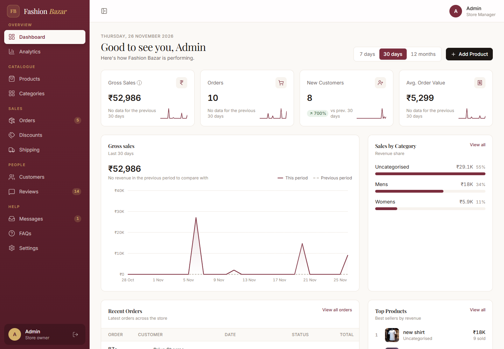
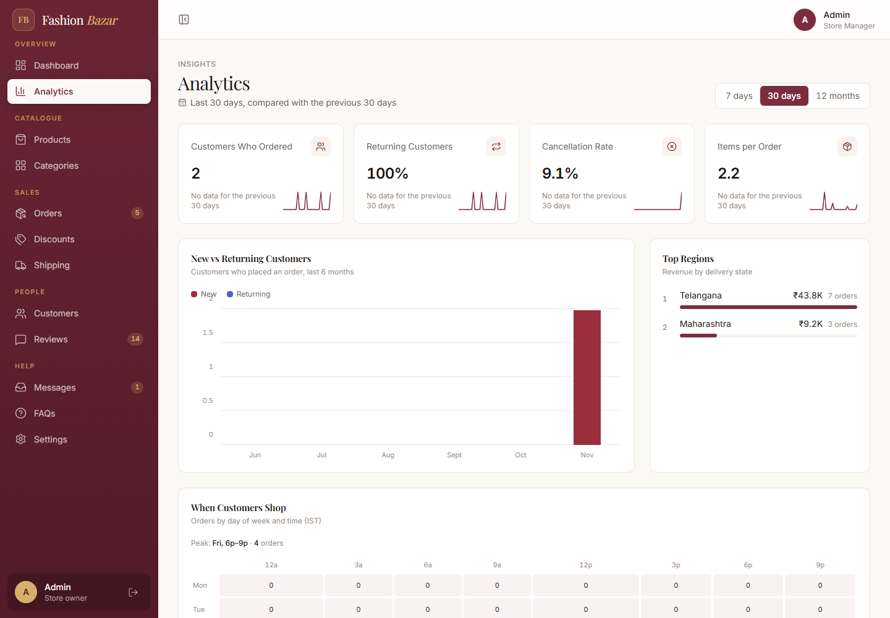
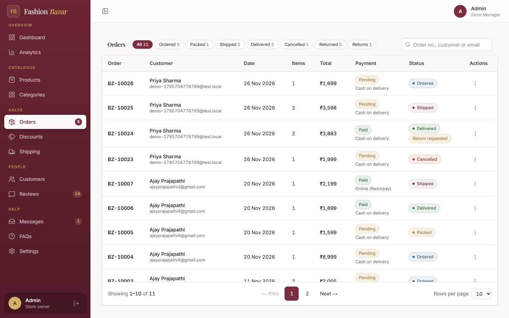
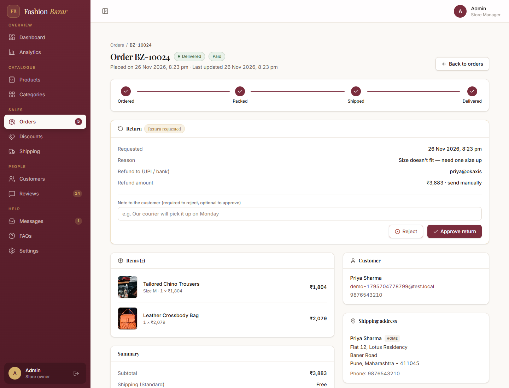
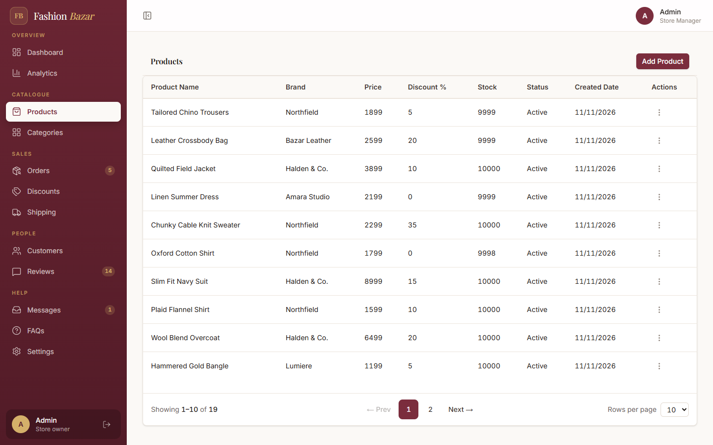
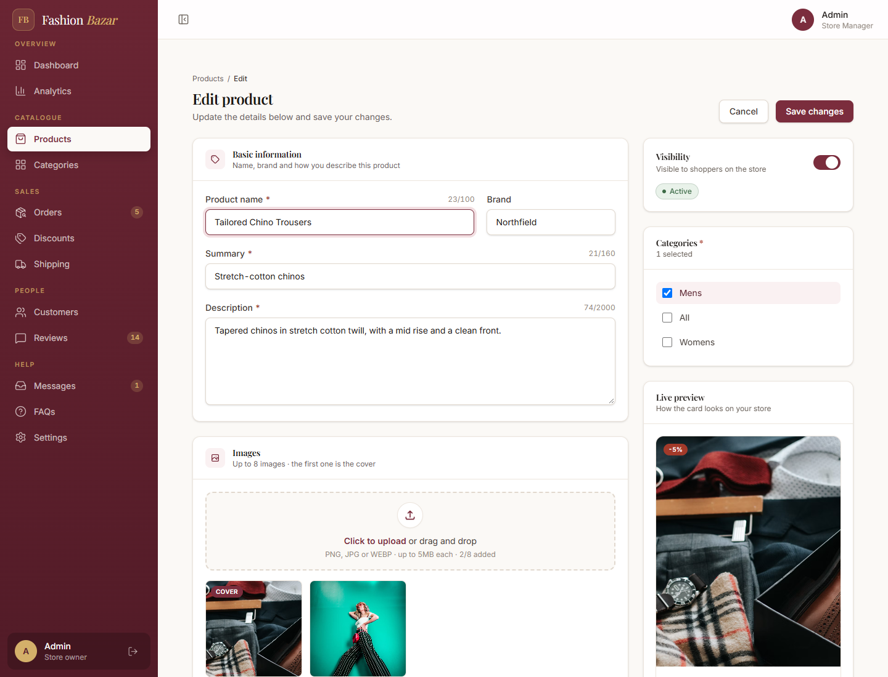
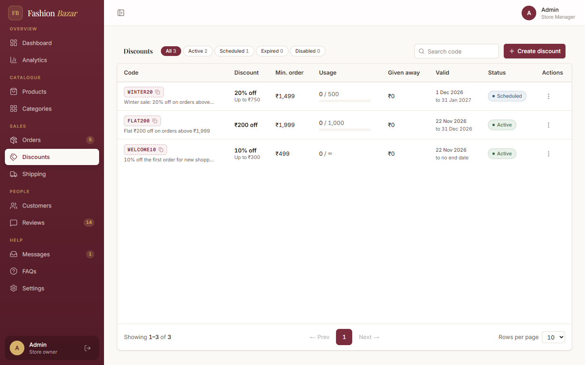

<div align="center">

# 🧑‍💼 Fashion Bazar — Admin Panel

**The back office of the Fashion Bazar store**
Live sales dashboard · orders, cancellations & returns · products with image upload · coupons · delivery rates · reviews · customer messages




</div>

---

## 📦 The Fashion Bazar project

Fashion Bazar is a full-stack fashion e-commerce platform split into three repositories:

| Repository | What it is | Stack |
|---|---|---|
| **[fashion_bazar](https://github.com/prajapathiAjay/fashion_bazar)** | Customer website | React 19 · Vite · Redux Toolkit · Tailwind |
| **fashion_bazzar_admin_panel** *(this repo)* | Admin panel | Next.js 16 · Redux Toolkit · Tailwind |
| **[fashion_bazar_backend](https://github.com/prajapathiAjay/fashion_bazar_backend)** | REST API | Node.js · Express · MongoDB |

Everything an admin changes here (products, prices, stock, coupons, delivery rates, store details) shows on the website straight away.

---

## 📸 Screenshots

<table>
  <tr>
    <td width="50%"><br><sub><b>Analytics</b>: customers, returning rate, cancellations, regions, heatmap</sub></td>
    <td width="50%"><br><sub><b>Orders</b>: status filters, return and refund badges, quick actions</sub></td>
  </tr>
  <tr>
    <td width="50%"><br><sub><b>Return request</b>: approve or reject, then receive and refund</sub></td>
    <td width="50%"><br><sub><b>Products</b>: stock, prices and status at a glance</sub></td>
  </tr>
  <tr>
    <td width="50%"><br><sub><b>Edit product</b>: images, sizes, price, discount and live selling price</sub></td>
    <td width="50%"><br><sub><b>Coupons</b>: usage, limits and validity</sub></td>
  </tr>
</table>

---

## ✨ Features

| Section | What the admin can do |
|---|---|
| **Dashboard** | Gross sales, orders, new customers and average order value, compared with the previous period (7 days, 30 days, 12 months). Sales chart, sales by category, top products, order status, low stock, recent activity |
| **Analytics** | Customers who ordered, returning-customer rate, cancellation rate, items per order, customer mix, top regions, sales heatmap, product performance |
| **Orders** | Move orders `Ordered → Packed → Shipped → Delivered` or cancel them (stock and coupon use go back, online payments are refunded through Razorpay) |
| **Returns** | Approve or reject a customer's return, mark the items received (back in stock, automatic Razorpay refund), or mark a cash-on-delivery refund as sent |
| **Products** | Add, edit, hide and delete products with up to 8 images (Cloudinary), sizes, price, discount and stock. Selling price is calculated live |
| **Categories** | Create, rename (links never break), hide or delete. Categories still used by products can't be deleted |
| **Coupons** | Percentage or flat, minimum order, maximum discount, usage limit, once per customer, start and end dates. Used codes are locked |
| **Delivery** | Delivery options, prices, free-delivery threshold and delivery days used at checkout |
| **Customers** | Every shopper with their addresses, orders and total spent |
| **Reviews** | Hide, show, reply to or delete reviews (the product rating updates automatically) |
| **Messages** | Contact-form inbox: read, resolve, reply by email |
| **FAQs** | Write, publish and unpublish the website's help centre |
| **Settings** | Store name, support email, phone, hours and address (shown on the website), and the admin's own password |

**Behind the scenes**
- **Protected routes**: nothing renders until a valid admin login is confirmed. Expired sessions, removed admin rights and 401 responses log out automatically and clear cached data
- **RTK Query** with cache tags, so lists, detail pages and the dashboard refresh after every change
- **Form validation** on every form, matching the backend's own rules
- Clear confirmations before anything that refunds money or can't be undone

---

## 🧱 Tech stack

| Area | Tools |
|---|---|
| Framework | Next.js 16 (App Router), React 19 |
| State & data | Redux Toolkit, RTK Query |
| Styling | Tailwind CSS 4, lucide-react icons |
| Charts | Hand-built SVG charts (no chart library) |

---

## 🚀 Getting started

### Requirements
- Node.js 20 or newer
- The **[backend](https://github.com/prajapathiAjay/fashion_bazar_backend)** running (default `http://localhost:3200`)
- An admin account (see below)

### Install and run
```bash
git clone https://github.com/prajapathiAjay/fashion_bazzar_admin_panel.git
cd fashion_bazzar_admin_panel/admin_panel
npm install
# create the .env file (see below), then:
npm run dev
```
Open **http://localhost:3000**. Keep port 3000: the backend only accepts this panel and the website from its allowed addresses.

### Environment variables
Create `admin_panel/.env` (it's in `.gitignore`, so it's never committed):

```env
NEXT_PUBLIC_API_URL=http://localhost:3200/api
NEXT_PUBLIC_STORE_URL=http://localhost:5173
```

| Variable | Description |
|---|---|
| `NEXT_PUBLIC_API_URL` | Backend API address |
| `NEXT_PUBLIC_STORE_URL` | Customer website address (for "view on store" links) |

> `NEXT_PUBLIC_` values are built into the browser code, so only addresses go here, never secrets.

### Create an admin account
There's no admin sign-up page, on purpose:
1. Sign up on the customer website.
2. In MongoDB, change that user's `type` from `"user"` to `"admin"`.
3. Log in here with the same email and password.

### Scripts
| Command | What it does |
|---|---|
| `npm run dev` | Development server |
| `npm run build` | Production build |
| `npm start` | Run the production build |
| `npm run lint` | ESLint |

---

## 📁 Folder structure

```
admin_panel/
├── app/
│   ├── (auth)/login/          Admin login
│   └── (admin)/               Every page behind the login
│       ├── layout.jsx         Login guard, sidebar, navbar
│       ├── dashboard/  analytics/
│       ├── orders/  products/  category/  discounts/  shipping/
│       ├── customers/  reviews/  messages/  faq/  settings/
│       └── <section>/new, [id], [id]/edit
├── components/                Forms, tables, charts and cards per section
└── lib/
    ├── api/                   RTK Query endpoints, one file per backend feature
    │   └── baseApi.js         API address, auth header, auto-logout
    ├── slice/authSlice.js     Login token
    ├── validation.js          Shared form rules
    └── uploadImages.js        Image uploads in batches
```

---

## ☁️ Deployment (Render)

1. Create a **Web Service** from this repo with root directory `admin_panel`.
2. Build command `npm install && npm run build`, start command `npm start`.
3. Add `NEXT_PUBLIC_API_URL` and `NEXT_PUBLIC_STORE_URL` with the live addresses.
4. Add this panel's live URL to the backend's `ALLOWED_ORIGINS`.

---

## 👤 Author

**Ajay Prajapathi** · [GitHub @prajapathiAjay](https://github.com/prajapathiAjay)
